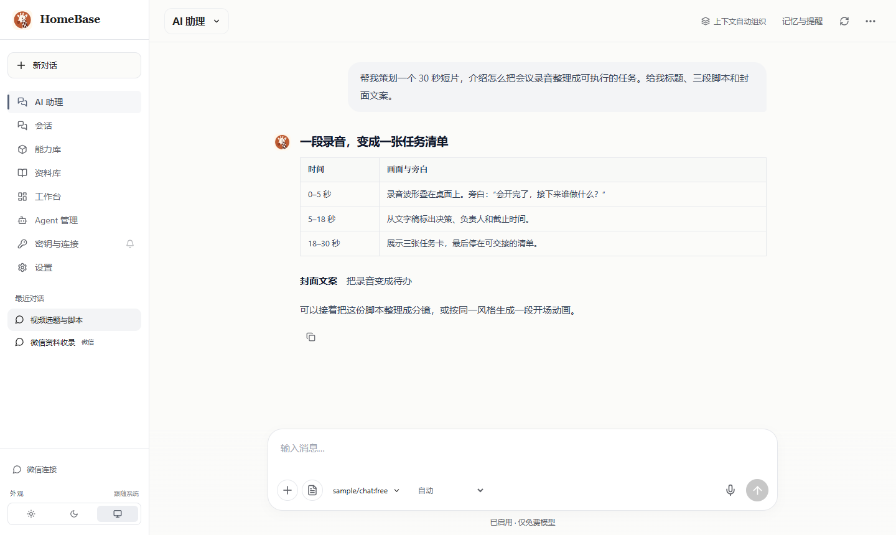
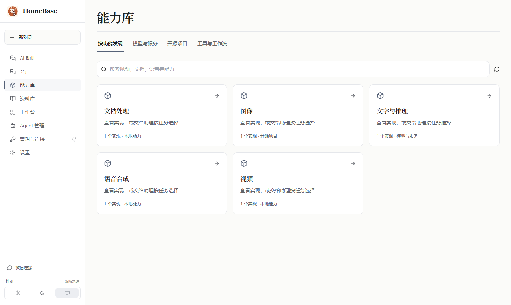

<p align="center">
  
</p>

<h1 align="center">HomeBase</h1>

<p align="center"><strong>A local-first AI assistant and tool workspace</strong></p>

<p align="center">
  <a href="README.md">简体中文</a> · English
</p>

<p align="center">
  <a href="#quick-start">Quick start</a> ·
  <a href="#features">Features</a> ·
  <a href="docs/index.md">Documentation</a> ·
  <a href="CONTRIBUTING.md">Contributing</a>
</p>

HomeBase brings chats, tasks, and local tools into one Windows workspace. Ask from the desktop or WeChat, let the Pi assistant choose a tool, and check progress or retrieve the result when it is ready. The capability library groups model services, MCP servers, skills, and integrated open-source projects by what they can do.



## Features

| Feature | What you can do |
| --- | --- |
| **Pi assistant** | Ask questions, attach materials, and run tasks in a single conversation with memory, reminders, and context summaries. |
| **WeChat connection** | Pair by QR code, then assign tasks, check progress, and receive files from your chat. |
| **Capability library** | Explore model services, local tools, MCP servers, skills, and open-source projects by function. Hand a selected capability to the assistant with its context. |
| **Conversations and workbench** | Review desktop, WeChat, and connected agent conversations alongside task activity and reported usage. |
| **Knowledge and credentials** | Browse project materials and manage encrypted credentials, rotation, and expiration. |
| **Local CLI** | Let another AI discover tools, validate inputs, and recover original task progress and artifacts. |

<details>
<summary>View the capability library</summary>



</details>

## Quick start

Set up Windows x64, Node.js 22.19 or later, stable Rust, MSVC C++ Build Tools, and the Windows SDK. Follow the [credential setup](docs/agent-keys.md) for SOPS and age.

```powershell
git clone https://github.com/Gdnbit/homebase-public.git
cd homebase-public
npm ci
npm ci --prefix agent-runtime --ignore-scripts
npm run tauri:dev
```

Enable a default model from the assistant's model settings. Open **WeChat Connection** and scan the QR code to use the same assistant from WeChat. The capability library shows tools and models available to your workspace.

[Windows packaging](docs/windows-packaging.md) · [Assistant guide](docs/assistant.md) · [WeChat guide](docs/wechat-integration.md)

## Connect another AI

From **Settings → Advanced Integration → AI Handoff**, copy the startup prompt. An external AI can use the CLI to inspect schemas and retrieve progress or results by the original task ID.

```powershell
.\hb.cmd bootstrap
.\hb.cmd commands
.\hb.cmd describe capability_index_query
```

[Agent entry point](control/START.md) · [CLI guide](docs/ai-control.md) · [Command reference](control/reference.md)

## Project documentation

- [Capability library and integrations](docs/capability-library.md)
- [Architecture and runtime](docs/architecture.md)
- [Testing and contributing](CONTRIBUTING.md)
- [Documentation index](docs/index.md)

HomeBase is available under the [MIT license](LICENSE). Dependencies retain their [third-party licenses](packaging/windows/THIRD-PARTY-NOTICES.md).
