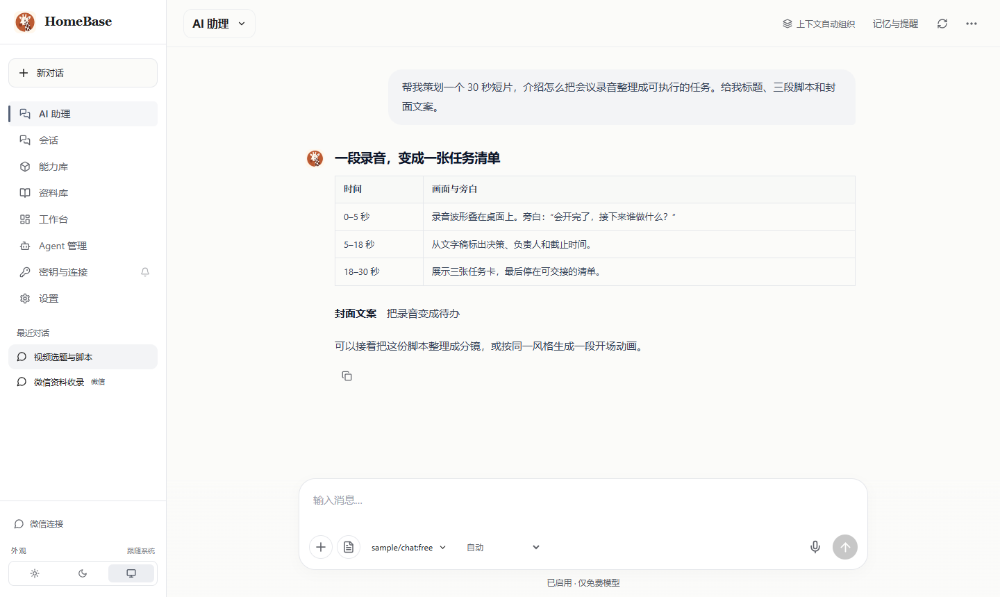
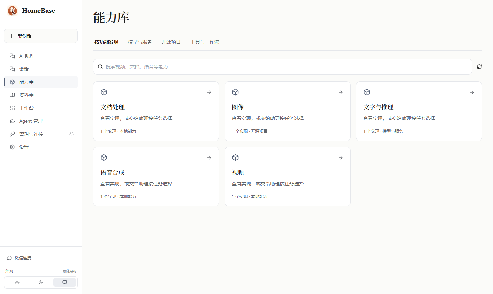

<p align="center">
  
</p>

<h1 align="center">HomeBase</h1>

<p align="center"><strong>本地 AI 助理与能力工作台</strong></p>

<p align="center">
  简体中文 · <a href="README.en.md">English</a>
</p>

<p align="center">
  <a href="#快速开始">快速开始</a> ·
  <a href="#功能">功能</a> ·
  <a href="docs/index.md">文档</a> ·
  <a href="CONTRIBUTING.md">参与贡献</a>
</p>

HomeBase 把聊天、任务和本机工具放进同一个 Windows 工作台。你可以在桌面或微信交办任务，让 Pi 助理选择合适的能力，再查看执行进度、继续处理或取回文件。模型服务、MCP、Skill 和已接入的开源项目集中在「能力库」，按要做的事查找。



## 功能

| 功能 | 使用方式 |
| --- | --- |
| **Pi 助理** | 在一个对话里提问、添加资料、执行任务。助理可使用长期记忆、提醒和上下文摘要。 |
| **微信连接** | 扫码绑定后，在微信对话中交办任务、查询进度、接收文件。 |
| **能力库** | 按功能比较模型服务、本机工具、MCP、Skill 和开源项目。选定能力后可带着上下文交给助理。 |
| **会话与工作台** | 查看桌面、微信及已接入 Agent 的对话，跟踪任务和已上报用量。 |
| **资料库与密钥** | 浏览项目资料，管理加密保存的密钥及轮换、到期状态。 |
| **本机 CLI** | 让其他 AI 发现可调用能力、校验参数、查询已有任务与产物。 |

<details>
<summary>查看能力库</summary>



</details>

## 快速开始

准备 Windows x64、Node.js 22.19 或以上、Rust stable、MSVC C++ Build Tools 和 Windows SDK。按[密钥环境说明](docs/agent-keys.md)准备 SOPS 和 age。

```powershell
git clone https://github.com/Gdnbit/homebase-public.git
cd homebase-public
npm ci
npm ci --prefix agent-runtime --ignore-scripts
npm run tauri:dev
```

从 **AI 助理 → 模型设置** 启用默认模型。从 **微信连接 → 扫码绑定** 在微信使用同一套助理。可以先在「能力库」查看当前可用的工具和模型。

[Windows 打包指南](docs/windows-packaging.md) · [助理使用指南](docs/assistant.md) · [微信绑定指南](docs/wechat-integration.md)

## 让其他 AI 使用 HomeBase

在 **设置 → 高级集成 → AI 接管** 复制启动提示词。外部 AI 可以通过 CLI 查看完整参数和返回结构，再按原任务编号查询进度与结果。

```powershell
.\hb.cmd bootstrap
.\hb.cmd commands
.\hb.cmd describe capability_index_query
```

[AI 操作入口](control/START.md) · [CLI 手册](docs/ai-control.md) · [接口参考](control/reference.md)

## 项目文档

- [能力库与接入方式](docs/capability-library.md)
- [架构与运行时](docs/architecture.md)
- [测试与贡献](CONTRIBUTING.md)
- [文档索引](docs/index.md)

HomeBase 使用 [MIT 许可证](LICENSE)。各依赖遵循其[第三方许可](packaging/windows/THIRD-PARTY-NOTICES.md)。
