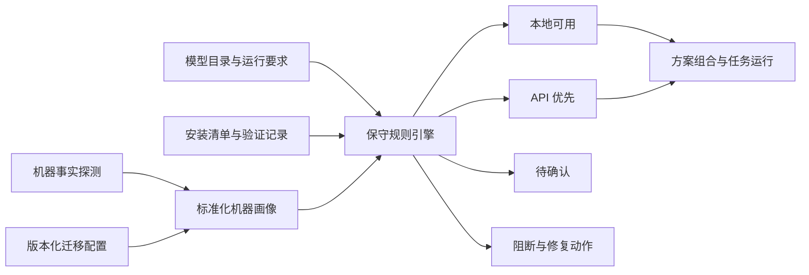

# ASR Production Recommendation and Portability

> **当前验证边界（2026-07-20）：** 推荐器 39 个边界用例、迁移协议 19 个边界用例、ASR
> 使用隔离夹具运行控制面测试、TypeScript 检查和生产构建；路由就绪状态在目标机器确认。
> “动态可推荐”不等于云端 provider 有额度，也不等于尚未下载的模型可以直接运行。

## Decision

推荐机制可以保持规则化和可解释，但边界处理必须达到生产级。推荐器的首要目标不是“尽量推荐”，而是：

1. 不把推测显示成事实。
2. 不把 probe、下载目录存在或模型卡声明等同于可运行。
3. 在任何环境下给出明确结论和下一步，不能留下空白状态。
4. 保留本地、云端或待诊断中的至少一条可执行路线。
5. 规则、证据、置信度和阻断项都能被测试和审计。

“推荐层达到生产级”不等于“整个 ASR 执行系统已经生产就绪”。下载任务队列、模型完整性校验、最小推理测试、Runner、MCP 和云端熔断仍需分别通过验收。

## Current Answer

当前已经实现动态机器检测和保守推荐：页面加载时从 Tauri 获取本机事实，标准化后逐模型计算状态、原因、置信度、阻断项和下一步；机器或目录绑定变化后会重新计算。没有 GPU、只有核显、虚拟显卡、多 GPU、显存未知、CPU/RAM 不足、空间不足、目录不可写、运行时缺失、安装清单损坏等情况都有显式分支和回归用例。

推荐规则本身是确定性的，不依赖大模型。大模型也不参与硬件探测、任务路由、文件发现或状态恢复；它只在用户选择时参与转写融合、标题、摘要和深度复核。当前仍需版本化维护模型目录与阈值，新模型不会在没有元数据和测试的情况下被自动批准。

## Architecture

代码边界：

| Layer | File | Responsibility |
|---|---|---|
| Recommendation core | `src/lib/model-recommender.ts` | 纯函数规则、证据、置信度、下一步与汇总结论。 |
| Portability core | `src/lib/asr-portability.ts` | 版本化根目录、导入导出、密钥引用和迁移预检。 |
| Manifest probe | `src-tauri/src/commands/model_center.rs` | 只读解析安装清单，验证路径，区分 probe/partial/installed/corrupt。 |
| Human UI | `src/routes/QuickPanel.tsx` | 在当前板块展示结论、阻断项和迁移入口。 |
| Regression suites | `scripts/test-model-recommender.mjs`, `scripts/test-asr-portability.mjs` | 表驱动边界测试。 |

## Recommendation Contract

每个模型必须返回：

| Field | Meaning |
|---|---|
| `recommendation_status` | 单一主状态，不把互斥语义混在一个标签中。 |
| `reason` | 当前结论。 |
| `next_action` | 用户下一步可执行动作。 |
| `confidence` | `high`, `medium`, `low`。 |
| `warnings` | 可继续但需注意的条件。 |
| `blockers` | 当前不能继续的硬阻断。 |
| `decision_basis` | 实际用于决策的证据。 |
| `missing_dependencies` | 已确认缺失的运行时。 |
| `unknown_dependencies` | 未探测或版本不明确的运行时。 |

主状态：

| Status | User meaning |
|---|---|
| `installed` | 权重路径存在、运行时满足，且安装清单包含通过的最小推理验证。 |
| `recommended` | 已知条件满足，适合本地默认；仍先 probe、下载和 smoke test。 |
| `optional` | 可本地运行，但不是默认路线。 |
| `api_preferred` | 本地条件不足或不确定，但有明确云端备用路线。 |
| `needs_review` | 没有足够事实自动批准，也没有可直接替代的 API。 |
| `partial_install` | 只有 probe、目录缺失、安装不完整或校验失败。 |
| `missing_runtime` | 已确认缺少 Python、FFmpeg、CUDA 等依赖。 |
| `runtime_mismatch` | 已安装但运行时缺失，或版本/驱动组合不兼容。 |
| `storage_blocked` | 目标目录不可写。 |
| `space_blocked` | 模型、下载开销和安全余量超过可用空间。 |
| `unsupported` | 已知硬件条件不适合且没有本地降级路径。 |

## Boundary Matrix

| Boundary | Required behavior |
|---|---|
| No GPU | CPU 模型仍可推荐；GPU 模型转 API 或 `unsupported`。 |
| Multiple/virtual GPUs | 忽略 Oray、Parsec、IDD 和远程显示适配器；优先评估真实独显，再退到真实核显。 |
| Integrated GPU | 不把共享内存当独立显存；显存型模型转 API。 |
| Unknown GPU | 显示待确认；不能显示“无独显”。 |
| AMD discrete GPU | 不自动满足 CUDA 条件；需要 ROCm/DirectML 专用模型声明。 |
| NVIDIA without confirmed CUDA | 显示运行时未知或不兼容，不仅凭型号批准。 |
| VRAM inferred from model name | 只能作为提示；达到阈值也不能自动批准。 |
| RAM unknown | 高内存模型待确认或转 API。 |
| RAM below minimum | 本地阻断，优先轻模型或 API。 |
| CPU cores unknown/invalid | 不自动批准本地模型；要求重新探测或转 API。 |
| CPU cores below minimum | 本地阻断；只推荐更轻模型或已声明的 API fallback。 |
| No disk facts | 不生成虚假的盘符；提示绑定目录。 |
| Only system drive | 空间充足时允许继续，但提高保留余量并给警告。 |
| Configured root differs from largest disk | 严格使用配置根目录所在盘的容量和写入状态，不借用其他盘的结果。 |
| Configured root drive not detected | 进入待确认或 API fallback，不假定该盘存在。 |
| Unwritable root | 本地专用模型为 `storage_blocked`；有明确云端备用时返回 `api_preferred` 并保留本地阻断原因。 |
| Low free space | 计入 25% 下载开销和系统/数据盘安全余量。 |
| PATH probe failure | 运行时变成 unknown，不能变成 missing。 |
| One probe endpoint fails | 使用 `Promise.allSettled`；其他事实继续参与推荐。 |
| Manifest missing/invalid | 不把任何模型显示为已安装。 |
| Probe-only manifest entry | `partial_install`，明确“仅探测”。 |
| Download directory exists | 没有 smoke-test passed 记录时仍是 partial。 |
| Installed path missing | `partial_install`。 |
| Verified install + generic PATH probe unknown | 最小推理证据优先，保持 `installed`；PATH 未确认只作为非阻断警告。 |
| Runtime version mismatch | `runtime_mismatch` 或 API fallback。 |
| Runtime only appears in PATH | 仍是 unknown；必须执行命令、版本和兼容性探针。 |
| Legacy installed-ID list | 仅视为 probe 证据，不能证明路径、完整性或可推理。 |
| Browser preview | 明确标记预览数据；不伪造 CPU/RAM/GPU/磁盘。 |
| Invalid/missing model metadata | 大小、最低 RAM、最低 CPU 核心或显存字段缺失时不自动批准下载。 |
| Empty catalog | 明确提示修复/刷新目录并给出云端配置动作，不显示空白推荐。 |
| Optional-only catalog | 选择一个可试运行的本地候选，并明确它不会自动进入默认组合。 |
| API key missing/quota/rate limit | 属于执行前 provider health；方案必须自动跳过不可用 provider。 |
| Model removed upstream | 下载任务失败并保留原 catalog snapshot；不能静默换模型。 |
| Offline/proxy failure | 本地已安装模型仍可用；下载/API 路线显示网络阻断。 |
| All routes blocked | 汇总给出释放空间、轻模型、修运行时或配置 API 的恢复路径。 |

当前自动测试覆盖 39 组推荐边界和 19 组迁移边界。下载与执行层另有 Python/Rust 契约测试；真实 provider quota、限流和上游下架仍在每次实际运行时按供应商响应记录，不能仅凭静态预检推断。

## Portable Profile

迁移配置格式：`homebase-asr-portable-profile`, schema version 2。版本 1 可导入，并迁移为版本 2 的默认空自定义组合列表。

配置只包含：

- AIHub、模型、运行时、任务输出和缓存根目录；
- catalog、manifest、preset 的相对路径；
- 默认方案和启用方案；
- 最多 24 个命名自定义组合及其显式引擎 ID、融合模式、场景和语言；
- Secrets 的短名引用；
- 原始录音保留、下载前预检和安装后 smoke test 等策略。

配置明确不包含：

- API key 明文；
- 机器专属的临时 token；
- 原始录音、逐字稿或会议纪要；
- 模型权重本身；
- Python venv 的绝对内部路径。

迁移流程：

1. 源机器导出配置。
2. 目标机器导入配置并重新绑定五个根目录。
3. 检查路径合法性、目录碰撞、系统盘策略、容量和写入权限。
4. 在 Secrets 中按短名重新注册密钥。
5. 读取 catalog，验证或重新下载模型，不盲目相信源机器的安装状态。
6. 为每个启用模型建立隔离运行时并锁定版本。
7. 运行最小音频 smoke test。
8. 仅启用通过测试的预设；失败路线保留原因和修复动作。

### Supported production boundary

当前可验收边界是 Windows 桌面版。迁移配置可以跨 Windows 机器导入，但目标机必须重新探测硬件、磁盘、运行时、模型完整性和 provider health；源机器的安装状态不会作为目标机的运行事实。

不在当前自动批准范围内：Windows ARM64、macOS、Linux/WSL、ROCm、DirectML、网络共享模型盘和容器化 GPU。它们不会被猜测为可用，只能在增加专用探针、运行时声明和真实基准后进入推荐目录。

### Distributable edition status

Windows x64 `0.1.0` 已交付安装版和便携版，而不再只是可导入配置：

1. 随包提供 HomeBase、三个 helper、固定版本 Python/faster-whisper CPU runtime、FFmpeg、SOPS、age、AIHub runner/catalog/preset/MCP 快照。
2. 首次运行解析包内资源，创建用户数据目录，初始化本机加密 Secrets，并写入版本化机器状态。
3. 已有机器复用 `C:\HomeBase\Wiki`/`C:\HomeBase\Models`/`C:\HomeBase\Secrets`；新机器回退到 Documents 与 LocalAppData，Quick Panel 可再重绑定。
4. 普通应用包不包含模型权重、录音、输出和密钥；目标机必须重新探测、下载/校验模型并注册 Key。
5. 发布流程生成 NSIS、便携 ZIP、组件/版本清单、SHA-256 和 14 项 Package Doctor 结果。
6. 最终便携目录已经独立启动验证，包内 SOPS/age 已完成隔离加解密往返。

面向更广泛机器发布前仍需：商业代码签名；干净 Windows 10/11 VM 的安装、卸载和覆盖升级矩阵；
catalog/preset 签名与回滚；可选离线模型包；用户数据备份/恢复；CPU-only、核显、NVIDIA、AMD、
低内存、低磁盘、离线和 provider 无额度机器的完整发布矩阵。详情见 `docs/windows-packaging.md`。

若要把界面移植到 HomeBase 之外的另一个产品，还应把 ASR 工作台从路由文件拆成独立 feature package，通过 `AsrHostAdapter` 注入系统探测、文件选择、任务 API、Secrets 和主题 token；组件本身不能持有盘符、Tauri 命令或 HomeBase 导航假设。

## Product Patterns Adopted

| Product/project | Pattern adopted |
|---|---|
| LM Studio | 模型目录可选择；下载任务有明确状态；下载前展示模型变体与大小。 |
| GPT4All | 模型卡显示文件大小、RAM、量化、开发者、许可证和校验信息。 |
| Stability Matrix | 数据目录可迁移，但路径必须重绑定和复检，不能只搬绝对路径。 |
| Open WebUI | 方案/模型包装可导入、导出和克隆；支持多模型并行查看。 |
| Buzz | 本地转写、多个 Whisper 后端、说话人识别、查看器和 CLI 共享同一能力。 |
| MacWhisper | 只有兼容模型才显示说话人能力；检测后允许人工重命名说话人。 |
| Fireflies/Otter | 同一任务空间内保留录音、逐字稿、说话人、摘要、行动项和检索。 |

Primary references:

- `https://www.lmstudio.ai/docs/app/system-requirements`
- `https://lmstudio.ai/docs/app/basics/download-model`
- `https://lmstudio.ai/docs/developer/rest/download`
- `https://docs.gpt4all.io/gpt4all_desktop/models.html`
- `https://docs.gpt4all.io/gpt4all_desktop/settings.html`
- `https://github.com/LykosAI/StabilityMatrix/wiki/FAQ-%26-Troubleshooting`
- `https://docs.openwebui.com/features/workspace/models/`
- `https://github.com/chidiwilliams/buzz`
- `https://docs.macwhisper.com/article/32-automatic-speaker-recognition-in-macwhisper`
- `https://guide.fireflies.ai/articles/6653885315-learn-about-the-fireflies-notepad`

## Production Exit Criteria

Recommendation and portability core are accepted when:

- all table-driven tests pass;
- browser preview never impersonates live hardware;
- probe-only and directory-only entries never show as installed;
- every recommendation includes reason, confidence and next action;
- no single probe failure erases all other machine facts;
- invalid migration config is blocked with a field-level repair action;
- exported config contains only secret references;
- the default desktop width and HomeBase's supported 1024 px minimum width have no overlapping or clipped controls。

The whole ASR board becomes production-ready only after these additional gates pass:

- resumable download jobs with progress, cancel, retry, hash/size verification and upstream-removal handling;
- isolated runtimes with locked dependencies and compatibility probes;
- real task planning/start/status/cancel commands;
- provider health, quota, cost cap, timeout, retry and circuit-breaker behavior;
- deterministic task-folder writes and crash recovery;
- MCP tools using the same contracts as the human panel;
- audit logs without secret or audio leakage;
- end-to-end tests on CPU-only, iGPU, NVIDIA, AMD, low-disk, offline and quota-exhausted machines.

## Implementation Status

| Area | Status on 2026-07-20 |
|---|---|
| Conservative recommendation core | Implemented and covered by 39 edge cases, including CPU thresholds, multi-GPU filtering, configured-root disk binding, invalid metadata and non-empty fallback summaries. |
| Portable profile and validation | Implemented and covered by 19 edge cases, including v1 to v2 migration and custom-combination validation. |
| Manifest read/probe semantics | Implemented in Tauri with Rust tests. |
| Quick Panel explainability | Implemented in current model/ASR board. |
| Real download job manager | Implemented as durable resumable jobs with progress, cancel, completeness verification and inference smoke checks before manifest installation. |
| ASR task Runner and MCP | Implemented against one canonical task contract; MCP and Quick Panel use the same preset, engine, task and artifact schema. |
| Native visual gate | Passed at the default desktop width and the configured 1024 px minimum width. A future 390 px floating/compact shell is a separate product and acceptance gate. |
